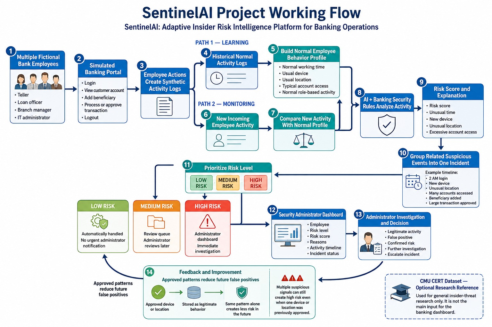

# SentinelAI

SentinelAI is an explainable insider-risk detection platform for simulated banking operations. It monitors fictional employee activity, identifies unusual behavior, prioritizes incidents, and displays understandable security alerts through an administrator dashboard.

> This project uses synthetic data for academic and demonstration purposes. It does not use real banking data.

## Objectives

- Learn normal behavior for different banking roles.
- Detect unusual employee activity using AI and security rules.
- Generate risk scores and explanations.
- Group related events into incidents.
- Prioritize low-, medium-, and high-risk incidents.
- Support administrator investigation and feedback.

## Project Flow

```text
Employee activity
      ↓
Synthetic activity logs
      ↓
Normal behavior learning
      ↓
AI-based anomaly detection
      ↓
Risk score and explanation
      ↓
Incident grouping and prioritization
      ↓
Administrator dashboard
```

## How SentinelAI Works




## Main Features

- Simulated employee banking portal.
- Employee activity monitoring.
- Role-aware behavior profiles.
- AI-based anomaly detection.
- Explainable risk scores.
- Alert grouping.
- Risk prioritization.
- Administrator investigation.
- False-positive feedback.
- Adaptive behavior improvement.

## Example

A teller normally logs in at 8 AM and accesses around 20 accounts. If the same account logs in at 2 AM using a new device, accesses 90 accounts, and approves a large transaction, SentinelAI creates a high-risk incident and explains the reasons.

## Technology Stack

- React.js
- Spring Boot
- Python
- FastAPI
- Scikit-learn
- PostgreSQL
- Docker

## Dataset

The project uses a synthetic banking dataset containing fictional employees, roles, shifts, login events, account access, devices, locations, beneficiaries, and transactions.

The CMU CERT dataset may be used separately as an optional research reference.

## Project Status

This project is under development.

## License

For academic and educational use.
